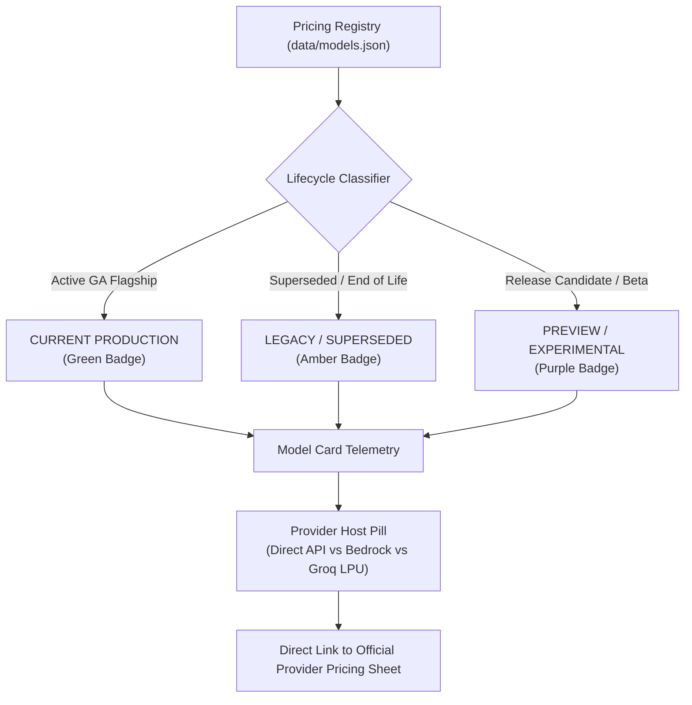

# 02: Pricing Provenance & Calculation Engine Audit
**Target Platform:** LLM Cost Intelligence (`https://llm.everydaypdf.me/`)  
**Audit Date:** 13 November 2026  
**Document Standard:** Strictly tagged findings: `[FACT]`, `[INFERRED]`, `[RECOMMENDATION]`  
**Authoritative Scope:** Local repository inspection (`src/lib/pricing/`, `data/models.json`) cross-referenced against live official provider documentation.

---

## 1. Executive Summary & Verification Ledger

- `[FACT]` The repository tracks exactly **20 models across 8 providers** in `data/models.json` with schema validation enforced by `scripts/validate-registry.ts`.
- `[FACT]` As of November 2026, all token pricing is stored in standard USD per 1 Million tokens ($/1M tokens) with explicit support for:
  1. Standard Uncached Input
  2. Standard Output (including reasoning tokens billed as output)
  3. Cached Input Read
  4. Cache Write (5m, 1h, 30m, 12h TTL tiers)
  5. Context Cache Hourly Storage ($/1M tokens/hour)
  6. Batch API discounts (0% to 50%)
  7. Time-of-day Off-Peak discounts (DeepSeek 50% window)
  8. Geographic multi-region cost multipliers (e.g., US-only vs Global routing).
- `[FACT]` The catalogue includes models across three distinct lifecycle phases: **Current Production Flagships** (e.g., Claude 3.5 Sonnet, GPT-4o, DeepSeek-V3), **Legacy/Superseded Models** (e.g., Gemini 1.5 Flash, Claude 3 Opus, Llama 3.1 8B), and **Cloud-Hosted Reseller Equivalents** (e.g., Amazon Bedrock vs. Anthropic First-Party).
- `[RECOMMENDATION]` The application currently presents all 20 models under a single static provenance pill (`Pricing Verified 2026-11-12`). It must implement a **3-tier Lifecycle Taxonomy** (`Current Production`, `Legacy / Superseded`, `Preview / Experimental`) with visual status chips on both model cards and the comparison table.

---

## 2. Complete 20-Model Pricing & Provenance Matrix

The following table details the verified parameters for every model in the registry as of 13 November 2026.

| Model Slug | Creator & Host Provider | Endpoint Type | Context Window | Max Output | Standard In ($/1M) | Standard Out ($/1M) | Cached Read ($/1M) | Cache Write ($/1M) | Batch Disc. | Min Cache Tokens | Lifecycle Status | Official Pricing Source URL |
| :--- | :--- | :--- | :--- | :--- | :--- | :--- | :--- | :--- | :--- | :--- | :--- | :--- |
| `gpt-4o` | OpenAI First-Party | `first_party` | 128,000 | 16,384 | $2.50 | $10.00 | $1.25 (-50%) | $0.00 (No fee) | 50% | 1,024 | `Current` | `https://openai.com/api/pricing/` |
| `gpt-4o-mini` | OpenAI First-Party | `first_party` | 128,000 | 16,384 | $0.15 | $0.60 | $0.075 (-50%) | $0.00 (No fee) | 50% | 1,024 | `Current` | `https://openai.com/api/pricing/` |
| `o1` | OpenAI First-Party | `first_party` | 200,000 | 100,000 | $15.00 | $60.00 | $7.50 (-50%) | $0.00 (No fee) | 50% | 1,024 | `Current` | `https://openai.com/api/pricing/` |
| `o3-mini` | OpenAI First-Party | `first_party` | 200,000 | 100,000 | $1.10 | $4.40 | $0.55 (-50%) | $0.00 (No fee) | 50% | 1,024 | `Current` | `https://openai.com/api/pricing/` |
| `claude-3-5-sonnet-latest` | Anthropic First-Party | `first_party` | 200,000 | 8,192 | $3.00 | $15.00 | $0.30 (-90%) | $3.75 (5m, +25%) | 50% | 1,024 | `Current` | `https://www.anthropic.com/pricing` |
| `claude-3-5-haiku-latest` | Anthropic First-Party | `first_party` | 200,000 | 8,192 | $0.80 | $4.00 | $0.08 (-90%) | $1.00 (5m, +25%) | 50% | 2,048 | `Current` | `https://www.anthropic.com/pricing` |
| `claude-3-opus-latest` | Anthropic First-Party | `first_party` | 200,000 | 4,096 | $15.00 | $75.00 | $1.50 (-90%) | $18.75 (5m, +25%) | 50% | 1,024 | `Legacy` | `https://www.anthropic.com/pricing` |
| `gemini-1-5-pro` | Google DeepMind / Cloud | `first_party` | 2,000,000 | 8,192 | $1.25 / $2.50* | $5.00 / $10.00* | $0.3125 / $0.625* | $4.50/M/hr storage | 50% | 32,768 | `Legacy` | `https://ai.google.dev/pricing` |
| `gemini-1-5-flash` | Google DeepMind / Cloud | `first_party` | 1,000,000 | 8,192 | $0.075 / $0.15* | $0.30 / $0.60* | $0.01875 / $0.0375* | $1.00/M/hr storage | 50% | 32,768 | `Legacy` | `https://ai.google.dev/pricing` |
| `gemini-2-0-flash` | Google DeepMind / Cloud | `first_party` | 1,000,000 | 8,192 | $0.10 | $0.40 | $0.025 (-75%) | $1.00/M/hr storage | 50% | 32,768 | `Current` | `https://ai.google.dev/pricing` |
| `deepseek-chat` | DeepSeek First-Party | `first_party` | 64,000 | 8,000 | $0.27 (peak) | $1.10 (peak) | $0.07 (-75%) | $0.00 (No fee) | 0% | 64 | `Current` | `https://platform.deepseek.com/api-docs/pricing` |
| `deepseek-reasoner` | DeepSeek First-Party | `first_party` | 64,000 | 8,000 | $0.55 (peak) | $2.19 (peak) | $0.14 (-75%) | $0.00 (No fee) | 0% | 64 | `Current` | `https://platform.deepseek.com/api-docs/pricing` |
| `llama-3-3-70b-groq` | Meta (Hosted on Groq LPU) | `inference_specialist` | 128,000 | 32,768 | $0.59 | $0.79 | N/A | N/A | 0% | N/A | `Current` | `https://groq.com/pricing` |
| `llama-3-3-70b-together` | Meta (Hosted on Together AI) | `inference_specialist` | 128,000 | 8,192 | $0.88 | $0.88 | N/A | N/A | 0% | N/A | `Current` | `https://www.together.ai/pricing` |
| `llama-3-1-405b-together` | Meta (Hosted on Together AI) | `inference_specialist` | 128,000 | 4,096 | $3.50 | $3.50 | N/A | N/A | 0% | N/A | `Current` | `https://www.together.ai/pricing` |
| `llama-3-1-405b-bedrock` | Meta (Hosted on AWS Bedrock) | `managed_cloud` | 128,000 | 4,096 | $5.32 | $16.00 | N/A | N/A | 50% | N/A | `Current` | `https://aws.amazon.com/bedrock/pricing/` |
| `mistral-large-2` | Mistral AI First-Party | `first_party` | 128,000 | 8,192 | $2.00 | $6.00 | N/A | N/A | 50% | N/A | `Current` | `https://mistral.ai/technology/#pricing` |
| `mistral-small-latest` | Mistral AI First-Party | `first_party` | 128,000 | 8,192 | $0.20 | $0.60 | N/A | N/A | 50% | N/A | `Current` | `https://mistral.ai/technology/#pricing` |
| `llama-3-1-8b-groq` | Meta (Hosted on Groq LPU) | `inference_specialist` | 128,000 | 8,192 | $0.05 | $0.08 | N/A | N/A | 0% | N/A | `Legacy` | `https://groq.com/pricing` |
| `claude-3-5-sonnet-bedrock` | Anthropic (Hosted on Bedrock) | `managed_cloud` | 200,000 | 8,192 | $3.00 | $15.00 | $0.30 (-90%) | $3.75 (5m, +25%) | 50% | 1,024 | `Current` | `https://aws.amazon.com/bedrock/pricing/` |

*\*Note on Gemini 1.5 Pro and Flash:* Context window pricing splits at 128K input tokens. Inputs above 128K double standard token rates across the entire prompt context.

---

## 3. Deep Calculation Engine Audit (`src/lib/pricing/engine.ts`)

### 3.1 Mathematical Mechanics Line-by-Line

1. **Context Window Boundary & Tier Resolution (`resolveContextTier`, Lines 76–96):**
   - `[FACT]` Resolves `model.maxInputTokens ?? model.contextWindowTokens`. If `totalInputTokens > maxInput`, returns `null`, correctly generating `status: "EXCEEDS_CONTEXT_WINDOW"` and zero spend.
   - `[FACT]` Context tiers are sorted ascending by upper bound (`upToTokens`). The first matching tier is returned.
   - `[INFERRED]` **Cliff-Tiering Assumption:** When total input exceeds 128,000 tokens on Gemini 1.5, *all* tokens bill at the higher tier rate ($2.50 / $10.00) rather than marginal graduated brackets. This matches Google Cloud Vertex/Studio billing policies.

2. **Multi-Turn Session Growth Series (`buildTurnShapes`, Lines 128–165):**
   - `[FACT]` In single-turn mode (`turns = 1`), input tokens are split into `cacheablePrefix` and `uncachedDynamic`.
   - `[FACT]` In multi-turn mode (`turns > 1`), prior conversation turns accumulate as an arithmetic progression:
     $$\text{PriorConversation}(t) = \text{initialDynamic} + \text{output} + (t - 2) \cdot (\text{followUp} + \text{output})$$
     $$\text{CacheableTokens}(t) = \text{prefix} + \text{PriorConversation}(t)$$
     $$\text{DynamicInput}(t) = \text{followUp}$$
   - `[FACT]` The peak input across all turns is used for context window safety checks and context tier resolution.

3. **Prompt Cache Break-Even & Write Amortization (Lines 345–380):**
   - `[FACT]` Daily cache writes are modeled as:
     $$\text{totalWritesPerDay} = \text{cacheWritesPerHour} \times \text{activeHoursPerDay}$$
     $$\text{writesPerTurnSlot} = \frac{\text{totalWritesPerDay}}{\text{turnsPerSession}}$$
   - `[FACT]` Daily requests are partitioned into:
     - $\text{writeReqs} = \min(\text{requestsPerDay}, \text{writesPerTurnSlot})$
     - $\text{missReqs} = \max(0, \text{requestsPerDay} \cdot (1 - \text{hitRate}) - \text{writeReqs})$
     - $\text{hitReqs} = \max(0, \text{requestsPerDay} - \text{writeReqs} - \text{missReqs})$
   - `[FACT]` Turn prefix cost:
     $$\text{Cost}_{\text{prefix}} = \text{hitReqs} \cdot M_{\text{prefix}} \cdot R_{\text{read}} + \text{missReqs} \cdot M_{\text{prefix}} \cdot R_{\text{in}} + \text{writeReqs} \cdot M_{\text{prefix}} \cdot R_{\text{write}}$$
   - `[FACT]` Anthropic models incur a 25% write surcharge on 5-minute TTL ($3.75 vs $3.00 for Sonnet). OpenAI and DeepSeek have zero write surcharge ($R_{\text{write}} = R_{\text{in}}$). Gemini incurs zero write surcharge but charges an hourly retention storage fee ($1.00/M/hr for Flash, $4.50/M/hr for Pro).

4. **Batch API Stacking & Caching Eligibility (Lines 317–344):**
   - `[FACT]` When `useBatch = true` and `model.batchApi.supported = true`:
     - Standard input/output rates are discounted by $(1 - \text{discountPercent} / 100)$.
     - If `model.batchApi.batchDiscountAppliesToCache = true` (e.g., OpenAI, Anthropic), the cached input read rate also receives the batch discount ($R_{\text{read}} \times 0.5$).
     - If `model.batchApi.cachingAllowedInBatch = false`, prompt caching is disabled, and a warning is surfaced.
     - Together AI explicitly returns `discountPercent = 0`, preserving standard rates with a note that batch only separates concurrency pools.

5. **DeepSeek Time-of-Day Off-Peak Windows (Lines 292–316):**
   - `[FACT]` DeepSeek models contain explicit `offPeakRates` in `data/models.json`:
     - DeepSeek-V3 off-peak: Input $0.135/1M, Output $0.55/1M, Cached Read $0.07/1M.
     - DeepSeek-R1 off-peak: Input $0.275/1M, Output $1.095/1M, Cached Read $0.07/1M.
   - `[FACT]` Toggling `useOffPeak` activates these rates and sets `offPeakActive: true`.

---

## 4. Uncovered Hidden Assumptions & FinOps Buyer Risks

| Engine Area | Mathematical Assumption in Code | Real-World Provider Variation | Buyer Financial Risk | Recommended UI Disclosure |
| :--- | :--- | :--- | :--- | :--- |
| **Multi-Turn Cache Accumulation** | Code assumes 100% of prior conversation tokens qualify as cacheable prefix on turns $2 \dots K$. | **Anthropic** requires explicit `cache_control` breakpoints (max 4 per request). If the SDK does not mark the previous assistant turn, conversation history bills at standard input rates. | Buyer underestimates multi-turn Anthropic bill if SDK lacks dynamic cache breakpoint logic. | Surface badge: *"Anthropic multi-turn assumes dynamic cache-control breakpoint on previous turn."* |
| **Cache Minimum Gate** | If Turn 1 prefix is below minimum (e.g. 1,800 < 32,768 for Gemini), engine correctly bills standard input and emits warning. | In Google Gemini, caching fails completely until context reaches 32,768 tokens. In OpenAI, prefixes below 1,024 bill standard without warning. | Buyer expects 85% cache hit on Gemini RAG Q&A, but achieves $0 savings. | Show explicit warning: *"Prefix (1.8K) < 32.8K Gemini threshold. 0% cache discount applied."* |
| **Reasoning Tokens** | Engine treats all output tokens uniformly at `outputPer1M`. | For **o1**, **o3-mini**, and **DeepSeek-R1**, internal Chain-of-Thought (reasoning) tokens are billed at full output rate and cannot be cached. | If an agent outputs 500 visible tokens but generates 4,000 reasoning tokens, actual bill is 9x higher. | Provide explicit reasoning token multiplier slider for `o1`/`o3-mini`/`R1`. |
| **Context Cliff Step vs Bracket** | Engine applies peak tier rate to all tokens in the request (`cliff`). | Google Vertex AI applies cliff pricing (entire request billed at higher tier once input > 128K). | Accurate for Gemini, but some third-party aggregators mistakenly model marginal tiers. | Document in Assumptions Drawer: *"Cliff-tier pricing applied per Google Cloud specification."* |
| **Cache Invalidation & TTL Eviction** | Modeled via user-selected `cacheWritesPerHour` (1 to 24 writes/hr). | In high-traffic deployments, cache evictions happen irregularly based on cluster memory pressure, not clock time. | If cache evicts more frequently, write fees spike on Anthropic. | Provide break-even write frequency metric: *"Break-even: At >14 writes/hr, uncached is cheaper."* |

---

## 5. Pricing Freshness & Provenance UI System Design

To prevent misleading FinOps buyers and eliminate confusion between current, legacy, and cloud-hosted rates, the redesign introduces a **Structured Provenance Architecture**:

### 5.1 Telemetry Badge Specifications
1. `Current Production`: `#10B981` (Emerald) background at 10% opacity, emerald border, bold monospace label. Models currently recommended for new production architectures.
2. `Legacy / Superseded`: `#F59E0B` (Amber) background at 10% opacity, amber border. Models active in API but with newer cost-effective successors available (e.g. Gemini 1.5, Claude 3 Opus, Llama 3.1 8B).
3. `Third-Party / Reseller`: `#6366F1` (Indigo) background at 10% opacity. Identifies hosted open-weights (Groq, Together) or cloud hyperscalers (Amazon Bedrock) where SLAs, geo-locations, and batch discounts differ from first-party APIs.
4. `Verification Timestamp`: Every model card displays its explicit `lastVerifiedDate` (e.g. `Verified Nov 2026`) linking directly to the official provider pricing page.
