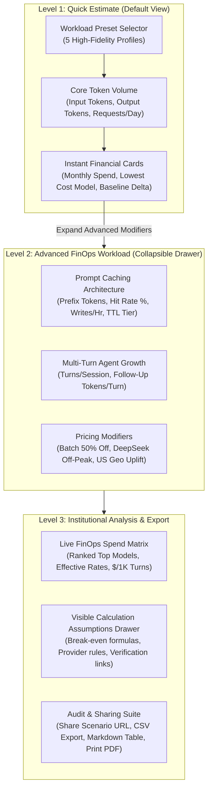

# 03: Institutional FinOps Design System & Information Architecture
**Target Platform:** LLM Cost Intelligence (`https://llm.everydaypdf.me/`)  
**Audit Date:** 13 November 2026  
**Document Standard:** Strictly tagged findings: `[FACT]`, `[INFERRED]`, `[RECOMMENDATION]`  
**Authoritative Scope:** Visual tokens, component ergonomics, progressive disclosure architecture, and accessibility specifications.

---

## 1. Information Architecture & Progressive Disclosure

### 1.1 The 3-Tier Calculator Progression

To resolve the cognitive overload of displaying 12 complex FinOps sliders simultaneously to first-time visitors, the redesigned architecture organizes calculation controls into **three progressive levels of disclosure**:

- **Level 1 (Quick Estimate):**
  - Designed for engineering managers, product leads, and developers needing immediate estimates in under 10 seconds.
  - Inputs: Workload Preset (1-click profiles) + Core Token Volume (Total Input, Total Output, Requests/Day).
  - Outputs: Instant Monthly Spend, Daily Spend, and Lowest Cost Option.
- **Level 2 (Advanced Workload Dynamics):**
  - Designed for FinOps analysts and architects modeling prompt cache break-even, multi-turn agent growth, and batch discounts.
  - Controls: Cacheable Prefix Tokens, Expected Cache Hit Rate (%), Cache Writes/Hour (cold write amortization), Cache TTL Selection (`5m` vs `1h`), Multi-Turn Conversation Depth, Follow-up User Tokens, Batch API (24h) toggle, and DeepSeek Off-Peak toggle.
- **Level 3 (Institutional Analysis & Provenance):**
  - Full 20-model comparative spend leaderboard, interactive assumptions inspector, effective $/1M breakdown, and enterprise export tools.

---

## 2. Financial Result Hierarchy (Data Prioritization)

Every financial metric presented in the interface follows a strict priority order grounded in buyer decision psychology:

1. **Monthly Projected Spend ($/mo):** Primary anchor for budgeting and Cloud/API PO approvals. Displayed in bold `font-mono tabular-nums text-2xl`.
2. **Daily Operational Spend ($/day):** Secondary telemetry showing run-rate burn.
3. **Cost per 1,000 Turns ($/1K Turns):** Unit economics metric normalizing cost across workloads with disparate turn lengths.
4. **Lowest Cost Valid Candidate:** Highlights the most economical model that satisfies the workload's context window constraints.
5. **Reference Baseline Delta:** Clear multiplier comparison against the designated frontier reference model (e.g. `12.4x cheaper than Claude 3.5 Sonnet`).
6. **Net Optimization Savings:** Highlights real dollars and percentage saved through Prompt Caching and Batch API stacking (`-$1,420/mo (-42.8%)`).
7. **Provenance & Assumptions Footnote:** Explicit last-verified timestamp and clickable provider source documentation.

---

## 3. FinOps Design System Tokens

### 3.1 Color Palette & Surface Tokens

| Token Name | Light Mode Value | Dark Mode Value | Usage / Semantic Role |
| :--- | :--- | :--- | :--- |
| `--surface-canvas` | `#F1F5F9` (Slate-100) | `#090D16` (Deep Navy-Black) | Global background canvas |
| `--surface-card-primary` | `#FFFFFF` | `#111827` (Gray-900) | Primary interactive panels and calculator cards |
| `--surface-card-secondary` | `#F8FAFC` (Slate-50) | `#161F30` (Navy-800) | Inset panels, input containers, drawer wells |
| `--border-subtle` | `#E2E8F0` (Slate-200) | `rgba(255, 255, 255, 0.08)` | Card borders and structural dividers |
| `--border-focus` | `#10B981` (Emerald-500) | `#10B981` | Interactive focus rings and active preset borders |
| `--text-primary` | `#0F172A` (Slate-900) | `#F8FAFC` (Slate-50) | Headings, primary labels, main values |
| `--text-secondary` | `#475569` (Slate-600) | `#94A3B8` (Slate-400) | Descriptions, input helper text, unit labels |
| `--accent-emerald` | `#059669` (Emerald-600) | `#10B981` (Emerald-500) | Lowest cost callout, positive savings, active pills |
| `--accent-cyan` | `#0891B2` (Cyan-600) | `#06B6D4` (Cyan-400) | Cache hit metrics, optimization KPIs, token tags |
| `--accent-amber` | `#D97706` (Amber-600) | `#F59E0B` (Amber-500) | Legacy models, promotional warnings, custom presets |
| `--accent-rose` | `#E11D48` (Rose-600) | `#F43F5E` (Rose-500) | Exceeded context windows, configuration errors |

### 3.2 Typography & Telemetry Rules

1. **Font Families:**
   - Primary Interface: Inter, `-apple-system`, `BlinkMacSystemFont`, `Segoe UI`, `sans-serif`.
   - Telemetry & Financial Values: `ui-monospace`, `SFMono-Regular`, `Menlo`, `Monaco`, `Consolas`, `monospace`.
2. **Tabular Figures Requirement:**
   - Every financial currency value, token counter, slider read-out, and table column MUST specify `font-variant-numeric: tabular-nums` (Tailwind class: `tabular-nums`). This prevents horizontal visual jitter as users drag sliders or toggle modifiers.
3. **Zero-Clipping Guarantee:**
   - No fixed pixel widths on text containers.
   - Long model names (e.g. `Llama 3.3 70B Instruct Turbo (Together AI)`) must wrap smoothly into two lines rather than mid-word truncation (`...`).
   - Token counters use adaptive formatting: `1,800` on desktop, `1.8k` on mobile chips.

---

## 4. Resolution of Known Live v2 Defects

### 4.1 Defect 1: Preset Card Tooltip Obstruction
- **Current Live Flaw:** Hovering over top-row cards (e.g. Document Summarization) triggers an absolute-positioned drawer (`absolute left-0 top-full z-40 mt-1.5 w-72`) that drops directly on top of row 2 cards (`Support Agent`, `Extraction`), preventing users from clicking them.
- **Proposed Redesign:**
  - Remove all absolute-positioned hover tooltips from preset buttons.
  - Implement an **Inline Contextual Bar** directly beneath the preset selector. When a preset is selected (or hovered), its traffic profile summary, token split, and architectural assumptions render in a stable, dedicated container that never obscures interactive controls.

### 4.2 Defect 2: KPI Optimization Contradiction
- **Current Live Flaw:** When the cheapest model in the leaderboard has 0% cache savings (e.g. Groq Llama 3.1 8B), the `OPTIMIZATION` KPI card showed `0.0% / No active discount`, directly contradicting the `-23.3%` cache discount badge on DeepSeek-V3 below.
- **Proposed Redesign:**
  - The `OPTIMIZATION` KPI card now calculates the **Weighted Workload Optimization Potential** across the model portfolio:
    - Primary display: Maximum available savings percentage across eligible models (e.g. `-23.3% with DeepSeek-V3` or `-50.0% via Batch API`).
    - Subtitle: Clear disclosure of which model and modifier produces that maximum saving.
    - If no modifiers are active, clearly state: `"Modifiers Inactive · Toggle Caching or Batch"`.

### 4.3 Defect 3: Misleading Frontier Baseline
- **Current Live Flaw:** String search on `gpt-4o` matched `gpt-4o-mini`, erroneously labeling a lightweight budget model as the "FRONTIER BASELINE".
- **Proposed Redesign:**
  - The baseline model selector now uses strict model hierarchy:
    - Default Frontier Baseline: `anthropic/claude-3-5-sonnet-latest` or `openai/gpt-4o` (exact ID match).
    - User Override: Users can designate any model in the catalogue as their custom reference baseline via a single-click dropdown or leaderboard pin.
    - Status label dynamically reflects the model's tier: `Frontier Flagship Baseline` for GPT-4o/Sonnet/o1, vs `Budget Tier Reference` for mini/haiku.

### 4.4 Defect 4: Mobile (`390px`) Table Pan Friction
- **Current Live Flaw:** Dense 8-column desktop table overflows horizontally on mobile devices, requiring cumbersome touch panning.
- **Proposed Redesign:**
  - On viewports `< 768px`, replace the wide table with **Stacked FinOps Model Cards**.
  - Each mobile model card displays:
    1. Rank, Model Name, Provider Badge, and Lifecycle Tag.
    2. Monthly Cost (large monospace) and Cost per 1K Turns.
    3. Visual progress bar showing relative cost vs lowest option.
    4. Expandable drawer revealing detailed input/output rates, cache read/write breakdown, and provider links.

---

## 5. WCAG AA Accessibility Specification

1. **Color Contrast Compliance:**
   - Normal text (14px/16px regular): Minimum contrast `4.5:1`. (Calculated dark mode `#F8FAFC` on `#111827` = `12.4:1`; light mode `#0F172A` on `#FFFFFF` = `15.8:1`).
   - UI components and borders: Minimum contrast `3.0:1`.
2. **Keyboard Focus & Navigation:**
   - All interactive controls (preset buttons, sliders, numeric textboxes, accordion triggers, export buttons) feature high-visibility focus indicators: `outline: 2px solid #10B981; outline-offset: 2px;`.
   - Sliders support standard arrow key increments (Left/Down: -1 step, Right/Up: +1 step; PageUp/PageDown: +10 steps).
3. **Screen Reader Telemetry (`ARIA`):**
   - The live spend leaderboard features `aria-live="polite"` with `aria-atomic="true"`, announcing updated monthly totals without interrupting active slider manipulation.
   - All sliders have corresponding `<label>` associations and `aria-valuemin`, `aria-valuemax`, `aria-valuenow`, and `aria-valuetext` (e.g. `aria-valuetext="1,800 cacheable prefix tokens"`).
