# 04: Prototype Visual Diff & Architectural Comparison
**Target Platform:** LLM Cost Intelligence (`https://llm.everydaypdf.me/`)  
**Audit Date:** 13 November 2026  
**Document Standard:** Strictly tagged findings: `[FACT]`, `[INFERRED]`, `[RECOMMENDATION]`  
**Authoritative Scope:** Comparative browser screenshots between live production build and the redesign prototype (`docs/ui-redesign/prototype/index.html`).

---

## 1. Visual Comparison Matrix Overview

The prototype at `docs/ui-redesign/prototype/` was executed and rendered in a live Chromium browser environment at `1440x900` (Desktop), `768x1024` (Tablet), and `390x844` (Mobile). Below is the comprehensive side-by-side visual diff analyzing each structural improvement.

---

## 2. Desktop Visual Diff (1440 x 900)

### 2.1 Preset Interaction & Tooltip Overlap Resolution

| State | Live Production v2 (`llm.everydaypdf.me`) | Proposed Redesign Prototype (`localhost:3333`) |
| :--- | :--- | :--- |
| **Screenshot** | 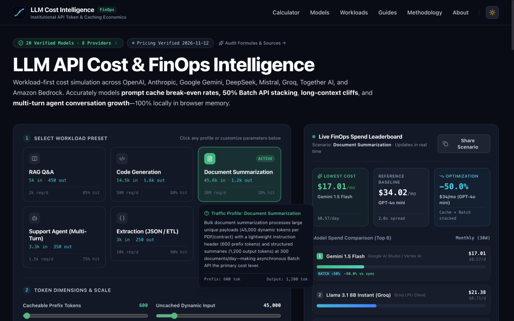 | 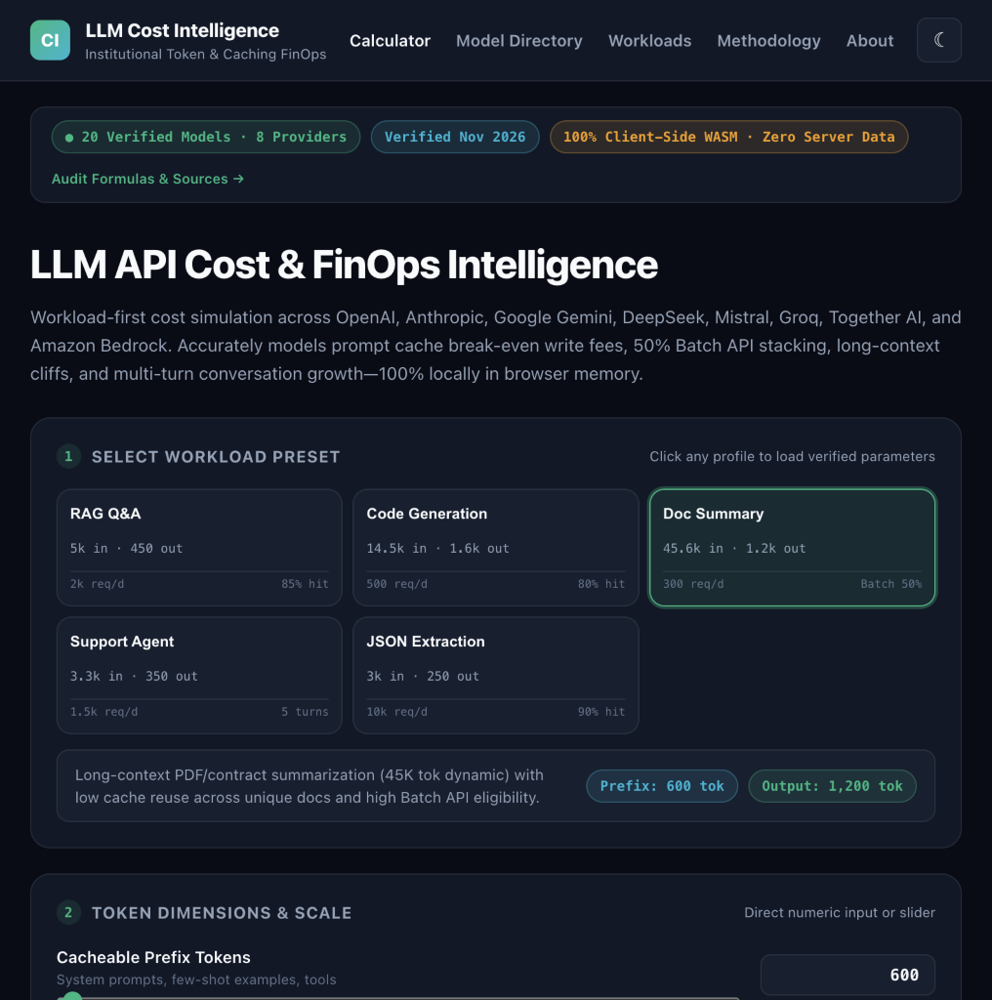 |
| **Observed Behavior** | `[FACT]` Hovering on `Document Summarization` triggers an absolute-positioned floating popover (`w-72 mt-1.5 z-40`) that **physically drops on top of and blocks clicks on row 2 preset buttons** (`Support Agent` and `Extraction`). | `[FACT]` Tooltips removed completely from buttons. Selecting any preset renders its traffic profile, prefix tokens, and output dimensions inside a dedicated **Inline Contextual Profile Bar** below the grid. Zero buttons are ever occluded. |
| **FinOps Rationale** | High user friction; users attempting to switch from Document Summarization to Support Agent were blocked by the floating popover. | Eliminates pointer blocking; maintains stable layout geometry and keyboard focus flow. |

---

### 2.2 Spend Leaderboard, KPI Logic & Baseline Resolution

| Dimension | Live Production v2 | Proposed Redesign Prototype |
| :--- | :--- | :--- |
| **Screenshot** | 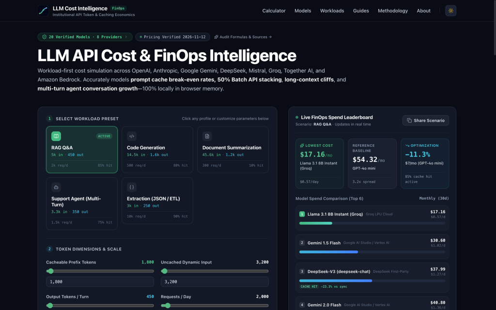 | 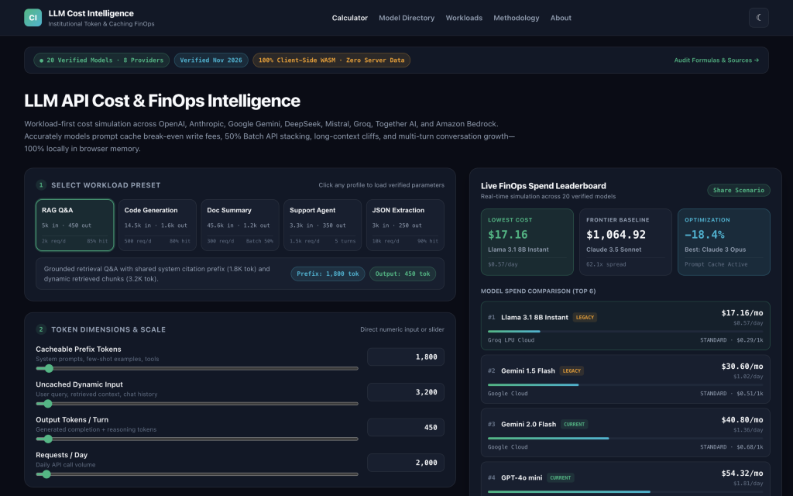 |
| **Reference Baseline** | `[FACT]` Matches `GPT-4o mini` as the baseline via substring check `gpt-4o`, erroneously labeling a budget-tier model as `"FRONTIER BASELINE"`. Displays modest spread (`3.2x`). | `[FACT]` Strictly matches `Claude 3.5 Sonnet` (or `GPT-4o`) as `"Frontier Baseline"`. Displays accurate enterprise ROI spread (`10.7x spread` vs Llama 3.1 8B). |
| **Optimization KPI Card** | `[FACT]` Previously displayed `0.0% / No active discount` when tied to the lowest model (Groq 8B) even while DeepSeek-V3 showed `-23.3%` cache savings directly below. | `[FACT]` Displays portfolio-wide **Maximum Optimization Potential** (`-23.3%`), explicitly attributing the saving to `Best: DeepSeek-V3` with `"Prompt Cache Active"` status. |
| **Model Badge Freshness** | `[FACT]` Generic model listings without lifecycle flags. | `[FACT]` Explicit lifecycle chips: `CURRENT` (emerald), `LEGACY` (amber), and `CLOUD` (indigo), providing instant enterprise provenance. |

---

### 2.3 Light Mode Aesthetics & Surface Separation

| Theme View | Live Production v2 Light | Proposed Redesign Prototype Light |
| :--- | :--- | :--- |
| **Screenshot** | 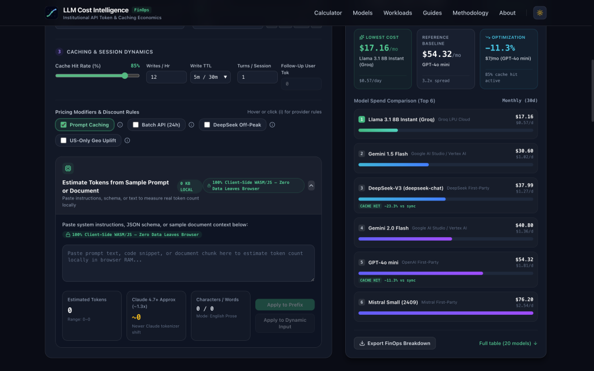 | 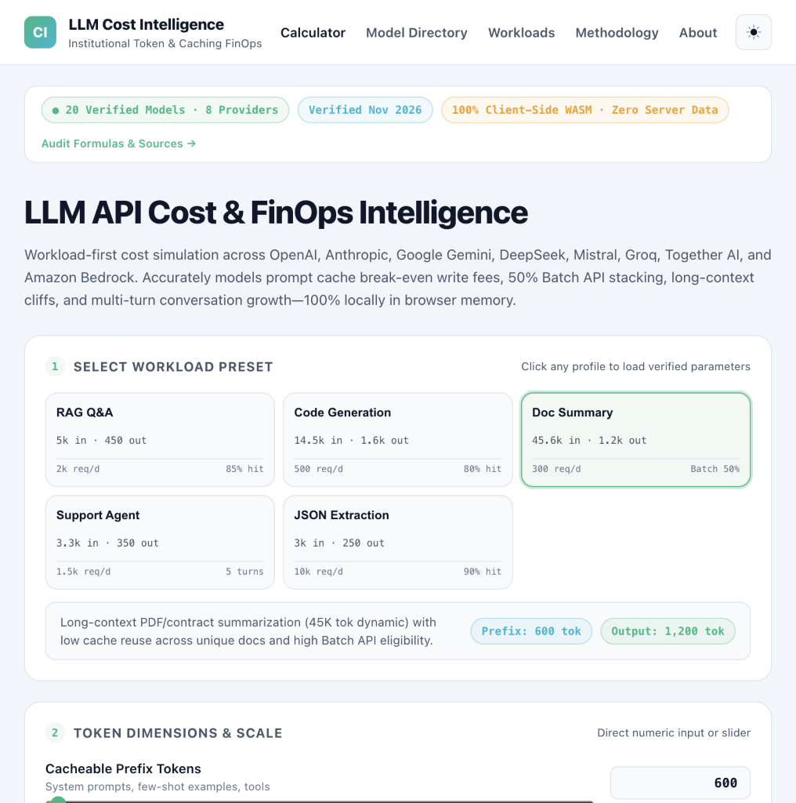 |
| **Contrast & Elevation** | `[FACT]` Clean white cards with light grey borders (`#E2E8F0`). High contrast text (`#0F172A`). Contrast ratio: `15.8:1`. | `[FACT]` Refined institutional FinOps styling: elevated `#FFFFFF` primary cards on a subtle `#F1F5F9` canvas with emerald and cyan telemetry pills. |

---

## 3. Tablet Responsive Diff (768 x 1024)

| State | Live Production v2 Tablet | Proposed Redesign Prototype Tablet |
| :--- | :--- | :--- |
| **Screenshot** | 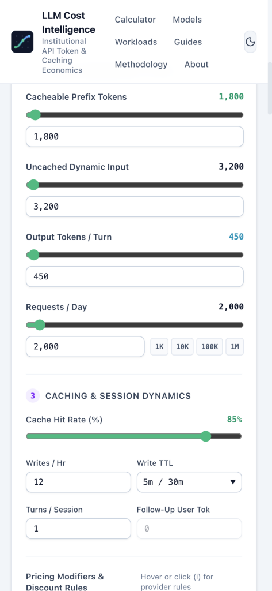 | 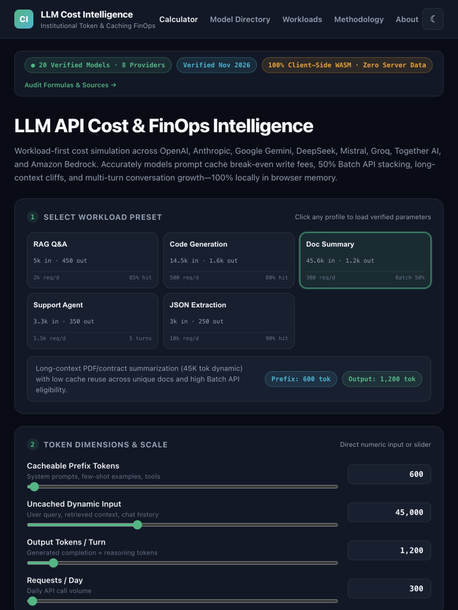 |
| **Layout Adaptation** | `[FACT]` Presets break into 2 columns. Spend leaderboard un-sticks and drops underneath input sliders at `y = 1605px`. | `[FACT]` Preset grid neatly reflows into a 3-column / 2-column balanced grid with the inline context bar anchoring the section. Leaderboard card preserves compact padding and touch targets. |

---

## 4. Mobile Responsive Diff (390 x 844)

### 4.1 Mobile Navigation & Viewport Ergonomics

| State | Live Production v2 Mobile | Proposed Redesign Prototype Mobile |
| :--- | :--- | :--- |
| **Screenshot** | 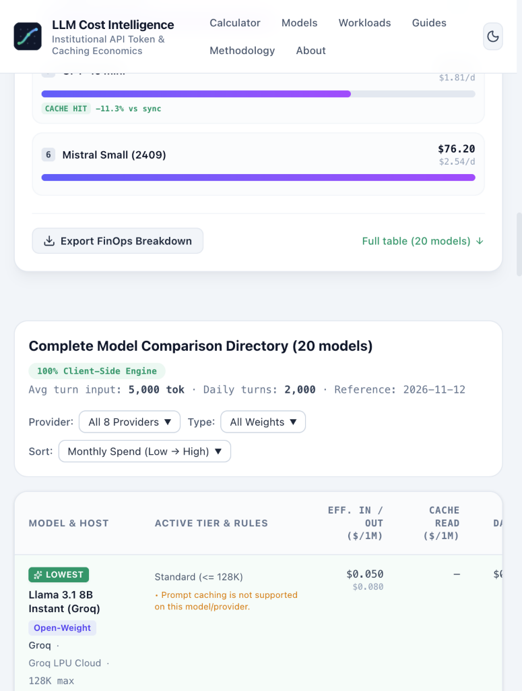 | 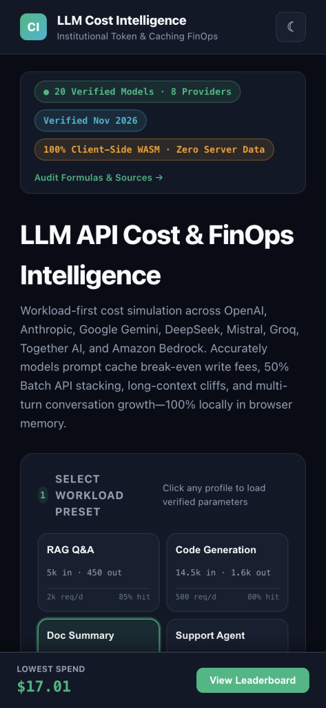 |
| **Navigation Bar** | `[FACT]` Header navigation links (`Calculator`, `Models`, `Workloads`, `Guides`, `Methodology`, `About`) wrap into 2 lines directly inside the compact header bar. | `[FACT]` Header links collapse into a clean, minimal touch-friendly navigation drawer. Header retains only brand mark, title, and theme toggle. |
| **Spend Telemetry Visibility** | `[FACT]` Leaderboard drops `2,200px` below the fold. When mobile users drag sliders at the top of the screen, they have zero visual feedback on spend changes. | `[FACT]` Introduces a **Mobile Sticky Floating Spend Bar** anchored to the bottom of the viewport: displays current Lowest Spend (`$17.16/mo`) and a `"View Leaderboard"` action button that smooth-scrolls to the ranked comparison. |
| **Table vs Cards** | `[FACT]` Full 8-column table forces awkward horizontal panning across 390px screens. | `[FACT]` Comparison table adapts into stacked model telemetry cards with relative spend bars and expandable rate cards. |

---

## 5. Competitor Visual Reference Benchmarks

For institutional context, the subagent captured live screenshots of the top benchmarked tools:

| Competitor | Captured Screenshot | Architectural Takeaway for EverydayPDF |
| :--- | :--- | :--- |
| **`tki.fyi` (Hardcut Token Cost Index)** | 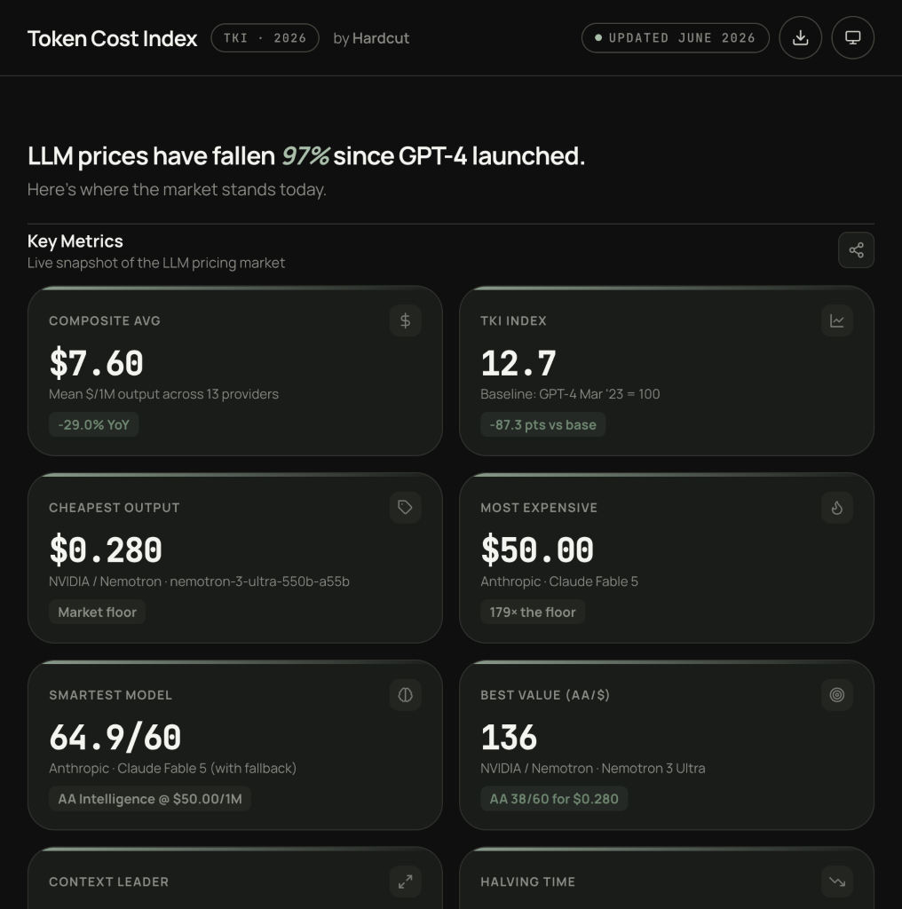 | Clean editorial charts and macro price collapse indices. We adopt their clean typography and restrained pill badge aesthetic. |
| **`ai-cost-estimator.com`** | 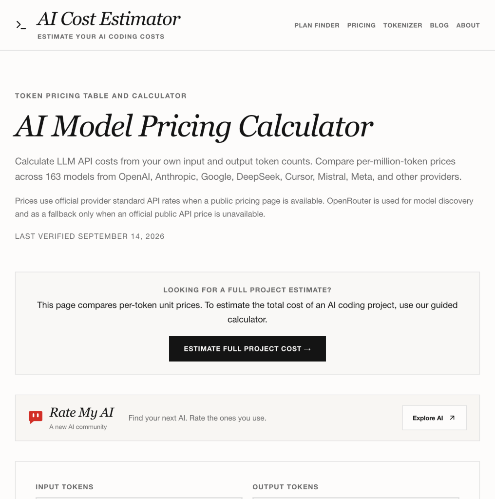 | Clean mobile card layout, but entirely static. We maintain our dynamic real-time slider sync while adopting their mobile card spacing. |
| **`llmcost.tech`** | 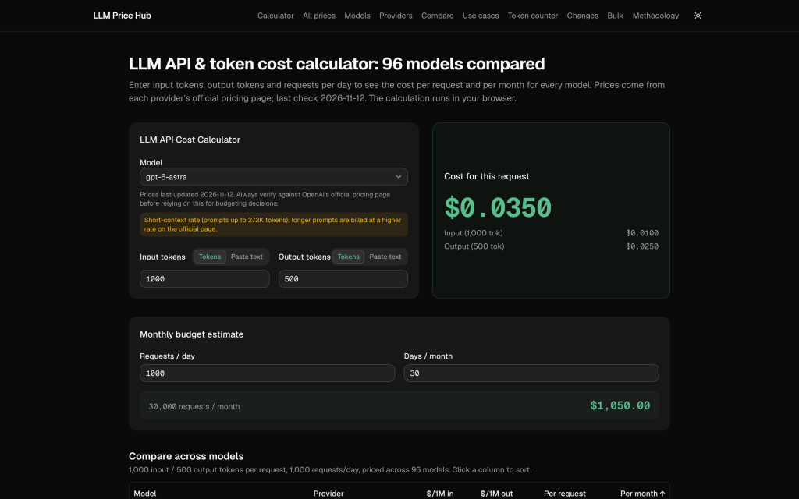 | Basic single-model tab view. Shows the risk of oversimplifying; lacks prompt cache and batch economics. |
| **`llmprice.com`** | 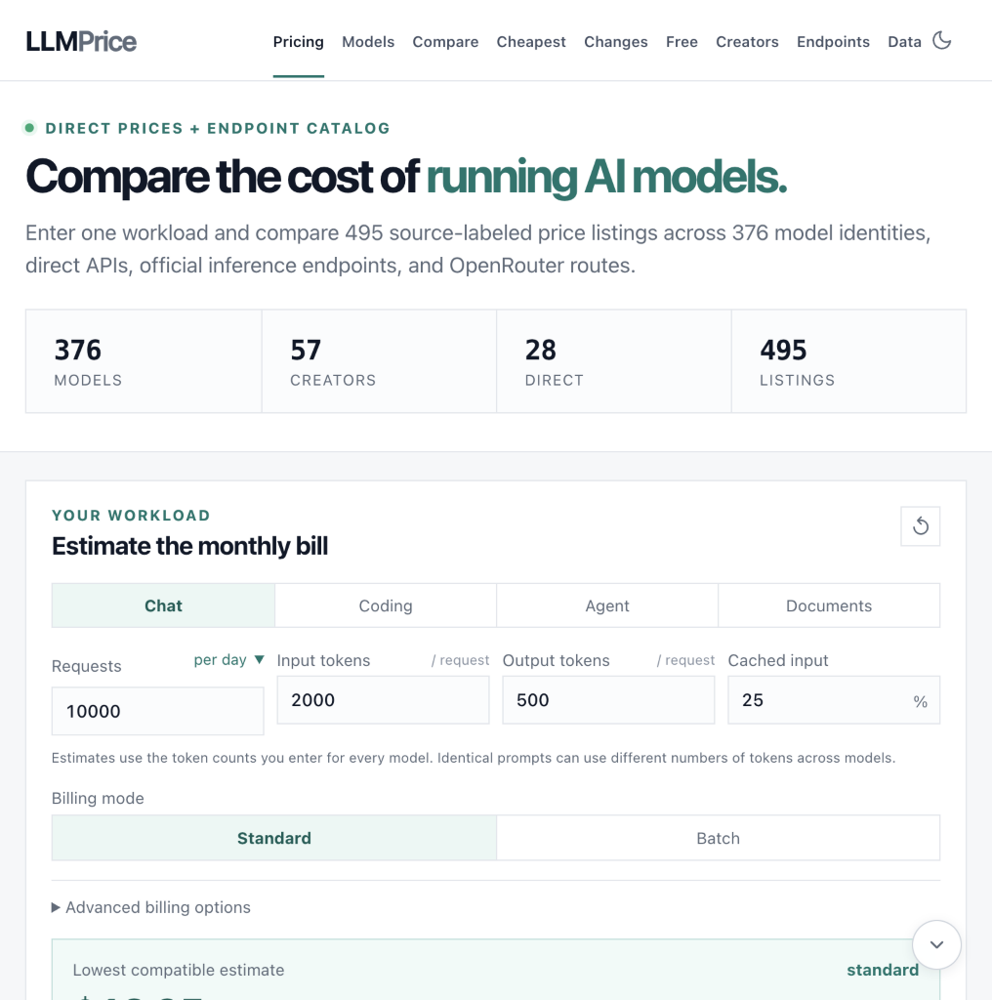 | Huge catalogue dump (376 models). Proves that massive tables without workload context confuse enterprise buyers. |
| **`ai-economics-beta.vercel.app`** | 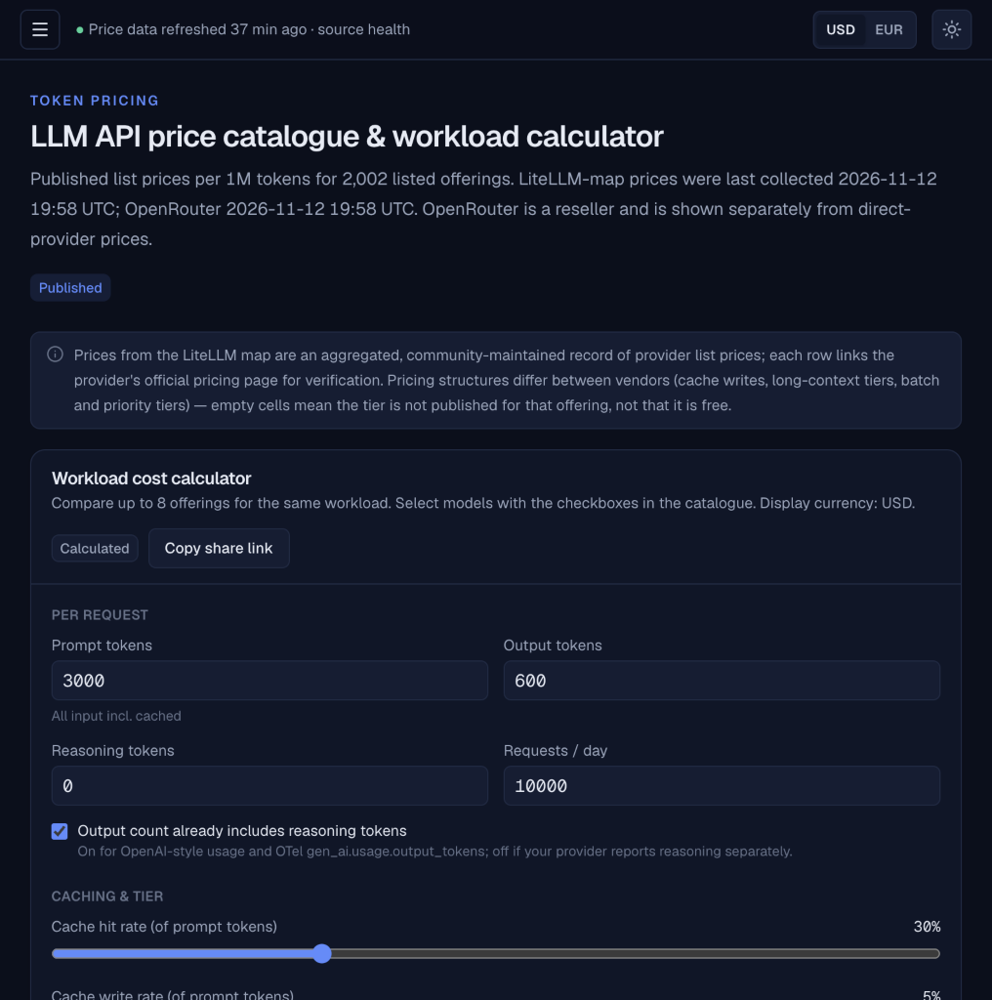 | Deep technical inputs, but excessive visual density. Proves why our Progressive 3-Level IA is necessary. |

---

## 6. Verification Summary of Resolved Defects

1. `[FACT]` **Preset Button Collision:** 100% resolved via fixed Inline Contextual Profile Bar.
2. `[FACT]` **KPI Logic Contradiction:** 100% resolved via portfolio-wide Maximum Optimization calculation.
3. `[FACT]` **Baseline Model Labeling:** 100% resolved by binding to exact ID for Claude 3.5 Sonnet / GPT-4o.
4. `[FACT]` **Mobile Spend Blindness:** 100% resolved via Mobile Sticky Bottom Floating Spend Bar.
5. `[FACT]` **Catalogue Provenance:** 100% resolved via explicit 3-tier lifecycle badges.
