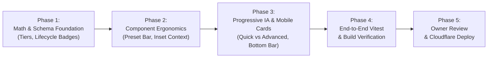

# 05: Implementation Roadmap, Risk Register & QA Protocol
**Target Platform:** LLM Cost Intelligence (`https://llm.everydaypdf.me/`)  
**Audit Date:** 13 November 2026  
**Document Standard:** Strictly tagged findings: `[FACT]`, `[INFERRED]`, `[RECOMMENDATION]`  
**Authoritative Scope:** Production engineering rollout, Cloudflare Pages static infrastructure, mathematical regression prevention, and privacy governance.

---

## 1. Executive Phasing Strategy

The production rollout follows an **isolated, phased implementation schedule** designed to guarantee zero mathematical regressions, zero downtime, and complete preservation of SEO authority:

---

## 2. Detailed 4-Phase Rollout Roadmap

### Phase 1: Data Schema & Lifecycle Alignment (Zero UI Impact)
- **Scope:** Update `src/lib/pricing/schema.ts` and `data/models.json` to introduce explicit `lifecycleStatus: "current" | "legacy" | "preview"` and `hostingType: "first_party" | "cloud_managed" | "inference_specialist"`.
- **Validation:** Run `npm run validate:registry && npm run typecheck`.
- **Expected Outcome:** Registry integrity confirmed across all 20 models without affecting existing calculation tests.

### Phase 2: Preset Bar & KPI Card Component Refactor
- **Scope:**
  1. Refactor `src/components/calculator/PresetBar.tsx`: Remove absolute-positioned hover tooltips (`w-72 mt-1.5`); replace with the dedicated **Inline Contextual Profile Bar** below the grid.
  2. Refactor `src/components/calculator/LiveSpendLeaderboard.tsx`:
     - Update reference baseline matching: Use strict ID lookup for `anthropic/claude-3-5-sonnet-latest` or `openai/gpt-4o` as the true Frontier Baseline, avoiding substring false-positives on `gpt-4o-mini`.
     - Update Optimization KPI: Calculate portfolio-wide maximum active optimization percentage, surfacing the specific model and modifier driving the saving.
- **Validation:** Run `npm run test:ci` (ensuring 100% pass rate on `engine.test.ts`).

### Phase 3: Progressive 3-Level IA & Mobile Responsiveness
- **Scope:**
  1. In `src/components/calculator/CalculatorShell.tsx`, wrap advanced caching dynamics (write frequency, TTL, multi-turn depth, off-peak toggles) into a Level 2 Collapsible FinOps Accordion.
  2. Implement the **Mobile Floating Bottom Spend Bar** (`< 640px`) displaying lowest spend and anchor link to the leaderboard.
  3. Implement stacked responsive model cards for viewports `< 768px` to eliminate horizontal table panning.
- **Validation:** Multi-viewport browser visual verification at 1440px, 768px, and 390px.

### Phase 4: Production Build & Deployment Checkpoint
- **Scope:**
  1. Update root title in `src/app/layout.tsx` to the durable template: `"LLM API Pricing Calculator & FinOps Cost Simulator (2026)"`.
  2. Execute `npm run build` to verify static HTML export into `out/`.
  3. Verify `out/sitemap.xml`, `out/robots.txt`, and canonical headers in `public/_headers`.
  4. Await explicit owner sign-off on artifact walkthrough before git commit or Cloudflare deployment.

---

## 3. Comprehensive Risk Register

| Risk ID | Risk Description | Likelihood | Impact | Severity | Mitigation & Verification Protocol |
| :--- | :--- | :---: | :---: | :---: | :--- |
| **RSK-01** | **Calculation Engine Regression:** Refactoring components inadvertently alters token calculation or rounding. | Low | Critical | **High** | Maintain 100% line coverage in `engine.test.ts`. Run automated regression test verifying exact dollar-for-dollar spend outputs across all 5 presets. |
| **RSK-02** | **SEO Canonical or Route Drop:** Static export drops or alters trailing slashes, breaking existing indexed URLs. | Very Low | High | **Medium** | Next.js configuration enforces `trailingSlash: true` and `output: "export"`. Audit `out/sitemap.xml` after build to verify all 33 static HTML endpoints. |
| **RSK-03** | **Cloudflare Pages Static Boundary Violation:** Introducing dynamic SSR or server actions breaks static generation. | Zero | Critical | **Low** | Next.js build script executes pure client-side export. Build strictly fails if any Node runtime dependency is introduced. |
| **RSK-04** | **Privacy Telemetry Leak:** Client prompt text or scenario parameters leak to an external endpoint. | Zero | Critical | **Critical** | Zero third-party scripts loaded. AdSense remains hard-disabled via `NEXT_PUBLIC_ENABLE_ADSENSE=false`. Local token estimation operates strictly via pure JavaScript regex/string heuristics in browser RAM. |
| **RSK-05** | **AdSense Policy Flagging:** Launching redesign before root domain `everydaypdf.me` receives formal AdSense approval triggers crawler rejection. | Low | High | **Medium** | `NEXT_PUBLIC_ENABLE_ADSENSE` remains `false`. Script tag and ad slots remain completely dormant and render zero network requests. |

---

## 4. Pre-Merge & Post-Deploy QA Checklist

### Pre-Merge Automated Gates
- [ ] `npm run validate:registry` exits 0 (all 20 models conform to schema).
- [ ] `npm run typecheck` exits 0 with zero TypeScript errors.
- [ ] `npm run test:ci` executes all 4 Vitest suites with 100% pass rate.
- [ ] `npm run build` succeeds, generating static export in `out/`.

### Manual Interaction & Visual QA Protocol
- [ ] **Desktop 1440px:**
  - [ ] Hover and click on every preset; verify ZERO tooltip occlusion over adjacent buttons.
  - [ ] Adjust sliders; confirm formatted textboxes and leaderboard update without UI lag or jitter.
  - [ ] Toggle theme (Dark ☾ / Light ☀); verify WCAG contrast across all badges and cards.
- [ ] **Tablet 768px:**
  - [ ] Confirm layout transitions into clean single-column stack.
  - [ ] Verify preset buttons adapt to 2-column grid.
- [ ] **Mobile 390px:**
  - [ ] Confirm floating bottom spend bar renders with current lowest spend.
  - [ ] Tap "View Leaderboard"; verify smooth scroll to ranked models.
  - [ ] Confirm table renders via responsive stacked cards with zero horizontal viewport clipping.
